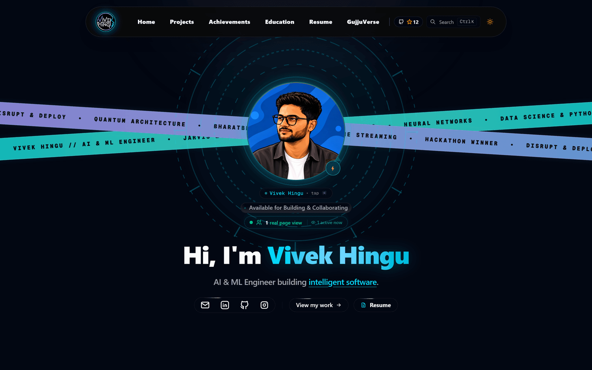
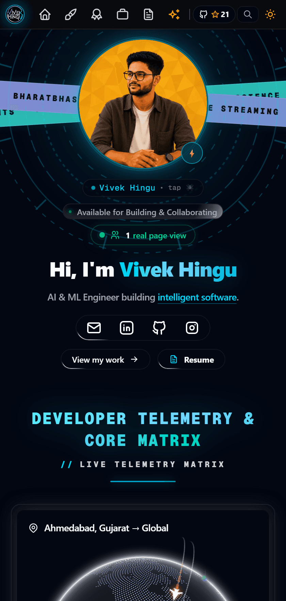
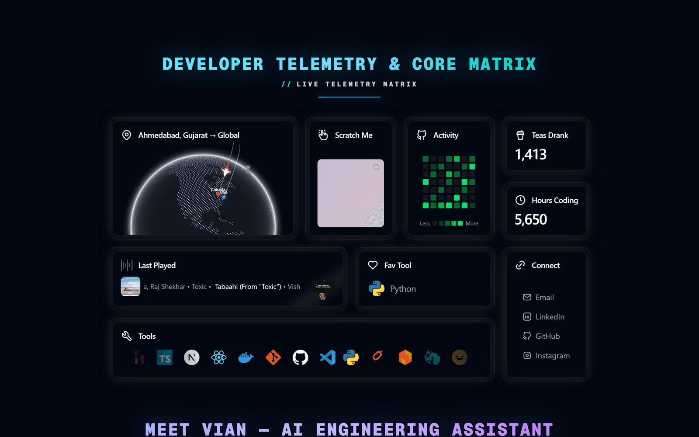
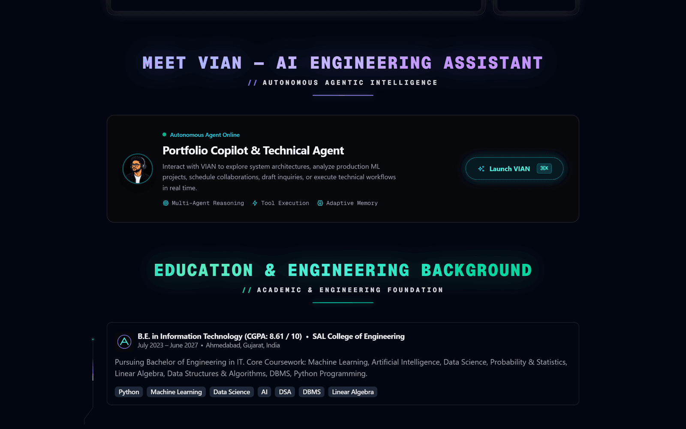
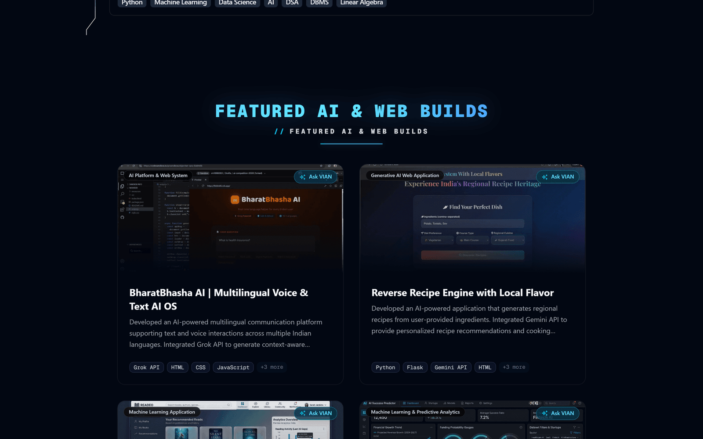
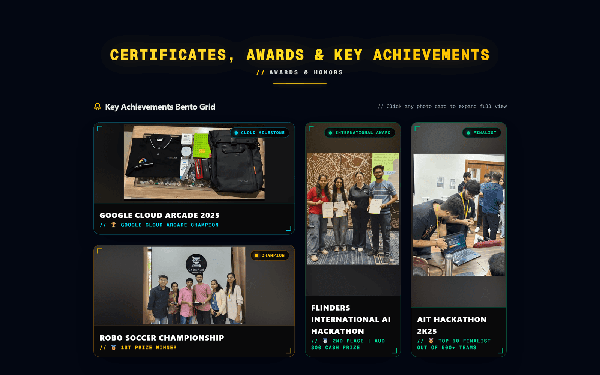
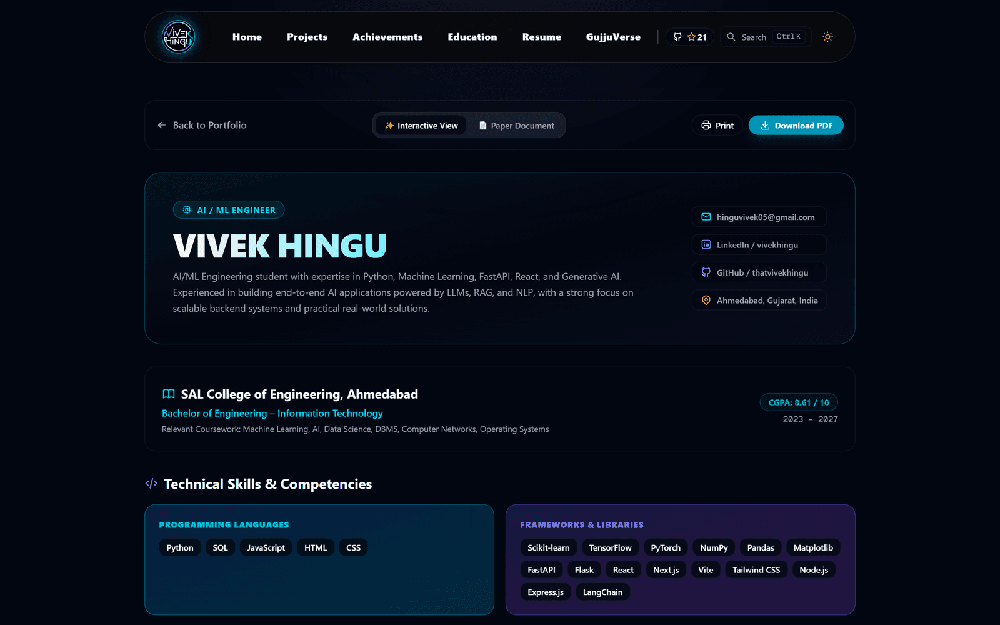
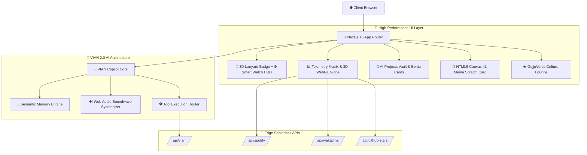

<div align="center">

```ascii
██╗   ██╗██╗██╗   ██╗███████╗██╗  ██╗    ██╗  ██╗██╗███╗   ██╗ ██████╗ ██╗   ██╗
██║   ██║██║██║   ██║██╔════╝██║ ██╔╝    ██║  ██║██║████╗  ██║██╔════╝ ██║   ██║
██║   ██║██║██║   ██║█████╗  █████╔╝     ███████║██║██╔██╗ ██║██║  ███╗██║   ██║
╚██╗ ██╔╝██║╚██╗ ██╔╝██╔══╝  ██╔═██╗     ██╔══██║██║██║╚██╗██║██║   ██║██║   ██║
 ╚████╔╝ ██║ ╚████╔╝ ███████╗██║  ██╗    ██║  ██║██║██║ ╚████║╚██████╔╝╚██████╔╝
  ╚═══╝  ╚═╝  ╚═══╝  ╚══════╝╚═╝  ╚═╝    ╚═╝  ╚═╝╚═╝╚═╝  ╚═══╝ ╚═════╝  ╚═════╝ 
```

# 🧠 Vivek Hingu — AI & ML Engineer
### Architecting Agentic Systems • Generative AI & LLMs • Computer Vision • High-Performance AI Interfaces

<br />

<p align="center">
  <a href="https://vivekhingu.vercel.app/">
    
  </a>
  &nbsp;
  <a href="https://vivekhingu.vercel.app/resume">
    
  </a>
  &nbsp;
  <a href="https://vivekhingu.vercel.app/#vian-assistant">
    
  </a>
</p>

<p align="center">
  
  &nbsp;
  
  &nbsp;
  
  &nbsp;
  
  &nbsp;
  
  &nbsp;
  
</p>

<br />

> *"Building intelligent software that bridges cutting-edge machine learning models with tangible, high-speed human experiences. Fuelled by Kadak Chai & pure code."*

</div>

---

## 📸 Portfolio Showcase & Live Previews

### 🖥️ 1. Ultra-Modern Hero HUD, 3D Physics Lanyard Badge & Cyber Smart Watch
Featuring a **physics-driven 3D hanging lanyard badge** with realistic mouse/touch tilt dynamics, holographic glass sheen, and metallic carabiner hook. Alongside sits an authentic **Cyber Smart Watch HUD** with physical digital crown, live IST digital clock, date telemetry, and real-time rotating mechanical spider gearwork, set against concentric Marvel Arc Reactor rings and edge-to-edge tech ribbons.

<div align="center">
  
</div>

<br />

### 📱 2. Mobile Responsive & Touch-Optimized Persona Experience
Optimized for mobile touchscreens with haptic feedback, floating micro-badges, and smart 2.8s auto-revert timers so alter-ego personas never get frozen during scroll or touch.

<div align="center">
  
</div>

<br />

### 🌐 3. Developer Telemetry & Core Matrix (Bento Grid)
Live telemetry dashboard featuring:
- **Interactive 3D Globe**: 4 global flight trajectories originating from Ahmedabad (India) to America, UK, Germany, and Canada.
- **Scratch-to-Reveal Card**: Curated 41 developer memes library with pastel gradient coating, haptic feedback, and instant random rotation.
- **Live Spotify Player**: Real-time song tracking with album artwork and animated soundwave monitor.
- **WakaTime & GitHub**: Live coding telemetry and commit activity heatmap.
- **Developer Tools Marquee**: Interactive toolbelt with custom tooltips.

<div align="center">
  
</div>

<br />

### 🤖 4. VIAN — AI Engineering Copilot
An autonomous engineering assistant with multi-agent reasoning, interactive iOS/macOS interface, dynamic soundwave synthesis, and real-time portfolio querying.

<div align="center">
  
</div>

<br />

### 🚀 5. Featured AI & Machine Learning Builds
Production-grade AI platforms including Startup Predictor, BharatBhasha AI 2.0, Reverse Recipe Engine, and Smart Book Recommender.

<div align="center">
  
</div>

<br />

### 🏆 6. Key Achievements Bento Vault
Dark frosted-glass frames with neon corner brackets showcasing major international hackathons, Google Cloud accolades, and robotics championships.

<div align="center">
  
</div>

<br />

### 📄 7. Interactive & Document Resume Suite
Dual-mode resume viewer supporting live skill category filtering, printable layout, and direct high-res PDF downloads.

<div align="center">
  
</div>

---

## ✨ Architectural Highlights & Interactive Features

| Feature | Description |
| :--- | :--- |
| **3D Physics Lanyard Badge** | Real-time 3D mouse/touch tilt physics badge with metallic carabiner hook, holographic glass sheen, and barcode telemetry. |
| **Cyber Smart Watch HUD** | Self-contained smartwatch with physical digital crown, live IST digital time, date telemetry, and real-time rotating spider gearwork. |
| **Edge-to-Edge Ribbons** | Full-bleed dual-angled tech ribbons (-3.5° / +3.5°) with high-contrast typography and infinite marquee animation. |
| **Marvel Arc Reactor Orbit** | Centered concentric sci-fi rings and iconic Avengers coordinate geometry rotating smoothly behind the profile avatar. |
| **4-Flight 3D WebGL Globe** | Interactive globe rendering individual flight trajectories from **Ahmedabad, India** to **USA**, **UK**, **Germany**, and **Canada**. |
| **41-Meme Canvas Scratch Card** | HTML5 canvas scratch-to-reveal card containing 41 curated developer memes with pastel gradient coating and instant shuffle. |
| **VIAN 2.0 AI Copilot** | Full-duplex conversational agent simulating native iOS Siri audio synthesis, tool execution, and architecture walkthroughs. |
| **Developer Telemetry** | Live WakaTime metrics, Spotify audio streaming telemetry, and GitHub activity heatmap. |
| **Bento Achievements Vault** | Neon corner-bracket frosted cards with uncropped high-resolution photos and milestone tags. |
| **GujjuVerse Culture Lounge** | Cultural storytelling section celebrating Gujarat's architecture, street vibes, and the Developer Manifesto. |

---

## 🏗️ System Flow & Core Architecture



---

## 🕹️ Interactive Easter Eggs & Secrets

Can you discover all the hidden interactive details baked into this portfolio?

| Target | Secret Trigger | What Happens? |
| :--- | :--- | :--- |
| 🪪 **ID Badge** | Click & drag in any direction | 3D physics tilt engine responds to mouse & touch coordinates |
| ⌚ **Smart Watch** | Click the digital crown | Triggers spring bounce animation & live second sweep synchronization |
| 🎰 **Meme Card** | Scratch 60%+ of the coating | Auto-reveals a curated developer meme with haptic vibration |
| ☀️ **Theme Toggle** | Click the theme button | Hilarious developer dark-mode quotes roast the light mode request |
| 🤖 **VIAN Copilot** | Ask *"Who is Vivek?"* or *"Kadak Chai"* | Unlocks personalized audio response and cultural easter eggs |

---

## 🛠️ The AI Engineering Arsenal

| Domain | Technologies & Frameworks |
| :--- | :--- |
| **Artificial Intelligence & ML** | `Python`, `PyTorch`, `TensorFlow`, `Scikit-Learn`, `OpenCV`, `NumPy`, `Pandas`, `SciPy` |
| **Agentic AI & Generative AI** | `LLMs`, `LangChain`, `LangGraph`, `RAG Architecture`, `Vector Search`, `HuggingFace`, `Prompt Engineering` |
| **Computer Vision** | `YOLOv8`, `Object Detection`, `Image Segmentation`, `Real-Time Video Analytics` |
| **System & Cloud Architecture** | `Next.js 15`, `React 19`, `TypeScript`, `FastAPI`, `Flask`, `Node.js`, `Docker`, `Tailwind CSS` |
| **Interactive 3D & Graphics** | `Three.js / WebGL`, `Framer Motion`, `HTML5 Canvas Engine`, `SVG Physics` |
| **DevOps & Version Control** | `Git`, `GitHub Actions`, `Linux / Bash`, `Vercel Edge Network` |

---

## 🚀 Getting Started Locally

### Prerequisites
- **Node.js**: v18.x or higher
- **Package Manager**: `npm` or `pnpm`

### Installation

```bash
# 1. Clone repository
git clone https://github.com/thatvivekhingu/thatvivekhingu-PFL.git
cd thatvivekhingu-PFL

# 2. Install dependencies
npm install

# 3. Start local development server
npm run dev
```

Open [http://localhost:3000](http://localhost:3000) in your browser to explore the portfolio locally.

### Production Build

```bash
# Run production compilation and bundle optimization
npm run build

# Start production server
npm run start
```

---

## 👤 Engineering & Identity

<div align="center">

**Vivek Hingu**  
*AI & ML Engineer • Intelligent Systems Architect*  

🎓 **SAL College of Engineering** — B.E. in Information Technology (CGPA: 8.61 / 10)  
📍 **Ahmedabad, Gujarat, India**  

<br />

<a href="https://linkedin.com/in/vivekhingu">
  
</a>
&nbsp;
<a href="https://github.com/thatvivekhingu">
  
</a>
&nbsp;
<a href="mailto:hinguvivek05@gmail.com">
  
</a>
&nbsp;
<a href="https://vivekhingu.vercel.app/">
  
</a>

<br /><br />

```
  ┌──────────────────────────────────────────────────────────────┐
  │ "Code with passion, build with precision, solve with AI."    │
  │                  — Vivek Hingu                               │
  └──────────────────────────────────────────────────────────────┘
```

<sub>Distributed under the <b>Apache License 2.0</b>. Built with precision, pride & ❤️ in Ahmedabad.</sub>

</div>
